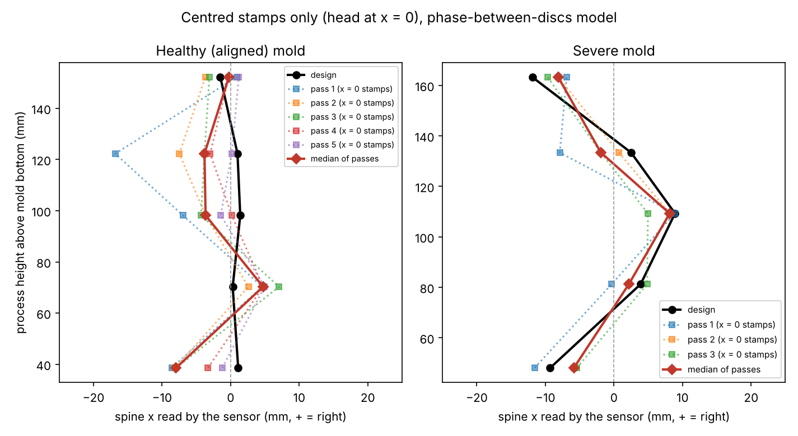

# Severe scoliosis phantom, 2026-11-23: validation

Data: `pc/final_data` (object `severe_scoliosis`, session 2026-11-23), 75 stamps: stamp rows
y = 0, 30, 60, 85, 125 mm × head x = -10, -5, 0, +5, +10 mm **from the mold centreline** × 3 reseats.
Head turned cw90 as on 11-22.

Mold map (bri, 2026-11-24; `MOLDS` in `pc/piezo/locate.py`): process x from the centreline =
(distance to left edge - distance to right edge) / 2; height above the mold bottom from the gaps.

| | T12 | T11 | T10 | T9 | T8 | design Cobb (segment / c-curve) |
|---|---|---|---|---|---|---|
| severe x (mm) | -9.3 | +3.9 | +8.9 | +2.5 | -11.9 | **47.4°** / 54.8° |
| moderate x (mm) | -3.75 | +3.9 | +7.4 | +3.3 | -6.3 | **30.8°** / 36.3° |
| aligned x (mm) | +1.1 | +0.3 | +1.4 | +1.0 | -1.5 | **7.0°** / 4.4° |
| severe/moderate height (mm) | 48.1 | 81.3 | 109.3 | 133.4 | 163.3 | |
| aligned height (mm) | 38.6 | 70.3 | 98.2 | 122.3 | 152.2 | |

The severe rows put a process 1-9 mm from the sensor centre (y = 0 → T12, 30 → T11, 60 → T10,
85 → T9, 125 → T8). On the aligned mold, the 11-22 rows were 4-15 mm off a process. The aligned
mold reads 7° by segment tilts because its vertebrae sit within ±1.5 mm of the centreline.

## Result: the healthy-trained locator does not see the scoliosis

Reproduce from `pc/`: `python ../analysis/severe_2026-11-23/validate_severe.py`.

| vertebra (stamp row) | 0 | 30 | 60 | 85 | 125 |
|---|---|---|---|---|---|
| design spine x (mm) | -9.3 | +3.9 | +8.9 | +2.5 | -11.9 |
| measured (median of 15 stamps) | -6.4 | +3.2 | +0.9 | +3.5 | +1.9 |
| mean abs error per stamp (mm) | 5.8 | 5.3 | 7.8 | 1.9 | 14.2 |

**Cobb (segment tilts): measured 20.9° (± 6.9° bootstrap) vs design 47.4°.** Rows 0, 30 and 85 are
right. Rows 60 and 125, where the spine is 9-12 mm off the centreline, read as if it were near 0.

Why (`what.py`): regressing the healthy model's prediction on the head's position in the mold (x) and
the spine's (S) gives **prediction = 0.72·x - 0.27·S**. A true spine reader would be 1·x - 1·S. So most
of what the model learned on the healthy mold tracks where the head sits *in the mold*, and only about
a third tracks the spine. On a straight mold those are the same thing, so the healthy CV couldn't show
it. A likely cause is the mold's side walls: the 107 mm mold is barely wider than the head, so ±10 mm
moves the outer discs much closer to an edge. With 5 rows this is suggestive, not proven.

## Phase between discs instead of amplitude (2026-11-24)

`phase_vs_amplitude.py`: same ridge model, trained on the healthy mold only, different features.

| features (50-190 Hz) | healthy CV MAE | severe MAE | prediction = a·x + b·S (spine reader: 1, -1) | severe Cobb (design 47.4°) |
|---|---|---|---|---|
| amplitude shares | 3.7 mm | 7.0 mm | 0.72 x - 0.27 S | 20.9° |
| phase vs drive | 3.2 mm | 5.3 mm | 0.76 x - 0.51 S | 25.8° |
| **phase between discs** | 3.8 mm | **4.7 mm** | **0.92 x - 0.70 S** | **34.6° (± 5.7°)** |
| resonance peak frequency | 7.1 mm | 13 mm | no signal | |

bri's hunch holds: amplitude follows contact pressure and the head's place in the mold. The phase of
each disc *relative to another disc* cancels whatever shifts all discs together, and it follows the
spine about 2.5 times better. Per vertebra (bottom to top) it reads -7.2, +0.6, +8.0, -0.7, -7.5 mm vs
design -9.3, +3.9, +8.9, +2.5, -11.9: right shape, about 70 % of the size, so the Cobb still under-reads.
It is now the default (`locator.py train --features phase-rel`, model `pc/models/locator_phase_2026-11-22.json`).

Honesty note: the feature set was picked after seeing the severe results, so the severe mold is no
longer a clean test. The moderate mold (design 30.8°) is: stamp it with the same layout and run
`validate_severe.py --mold moderate --model models/locator_phase_2026-11-22.json` (object name
`moderate_scoliosis`). With 50-400 Hz the severe Cobb read 43.5 ± 7.4° but the per-stamp error was
worse (5.8 mm), so 50-190 Hz stays the default.

## Screening (scoliosis yes/no) from stamps only on the centreline

Stamping only at x = 0 down the spine, then either the Cobb from those points or the spread (SD) of
the 5 spine positions:

| | healthy | severe |
|---|---|---|
| Cobb, 1 stamp per vertebra (phase) | 39.8 ± 11.7° | 41.6 ± 8.4° |
| spread SD, 1 stamp per vertebra (phase) | 4.8 ± 1.5 mm | 6.3 ± 0.9 mm (AUC 0.82) |
| spread SD, 3 stamps per vertebra (phase) | 4.1 ± 0.5 mm | 5.8 mm (one scan) |
| design spread SD | 1.0 mm | 7.9 mm (moderate 5.0) |

The Cobb from centreline-only stamps is useless (healthy reads ~40°): x = 0 is the model's noisiest
spot and segment tilts amplify that. The spread is more promising: with 3 centreline stamps per
vertebra the one severe scan sits above every resampled healthy scan. But that's one severe scan,
taken on a different day than the healthy ones, and the moderate mold's design spread (5.0 mm) would
sit right at the healthy noise floor (about 4 mm). So: probably yes for severe, unknown for moderate.

### Centred stamps only, one pass = one x = 0 stamp per vertebra (`centred_only.py`)

| | spread SD | C-bow (half-sine fit, + = middle bows right) | segment Cobb |
|---|---|---|---|
| severe pass 1 / 2 / 3 | 7.2 / 5.8 / 5.7 mm | **+13.4 / +13.4 / +12.5 mm** | 54 / 31 / 33° |
| healthy pass 1-5 | 2.3-7.5 mm | **-2.7 to +5.0 mm** | 23-53° |
| design severe / moderate / aligned | 8.0 / - / 1.0 mm | +19.0 / +12.0 / +1.4 mm | 47 / 31 / 7° |

The C-bow is the useful number: it asks "do the 5 points make one smooth curve", so a single noisy
vertebra (healthy pass 1 reads T9 at -17 mm) barely moves it, while it inflates the spread and the
segment Cobb. Every single severe pass reads 12.5-13.4 mm; every healthy pass reads -2.7 to +5.0 mm.
A threshold around 8 mm splits all 8 passes correctly. Limits: one severe mold scanned on one day,
a C-shaped curve only (an S-curve needs a different shape fit), the phase features were picked after
seeing severe, and the model reads about 70 % of the true bow, so the moderate mold (design bow 12 mm,
expected reading ~8.4 mm) would land right on that threshold.

## Drift correction as a preprocessing step (2026-11-25, `drift_correction.py`)

Within one stamp, drift is already handled: each tone's sine fit includes a slow quadratic drift term,
so baseline creep during the 0.4 s window doesn't leak into amplitude or phase. Across stamps, the
phase-between-discs features were tested with five corrections (healthy mold only for training):

| correction | healthy CV MAE | severe MAE | follows spine (b in a·x + b·S) | severe Cobb (47.4°) | centred C-bow severe / healthy |
|---|---|---|---|---|---|
| **none** | 3.75 | **4.66** | -0.70 | 34.6° | 12.5-13.4 / -2.7-5.0 mm |
| previous blank | 5.30 | 11.7 | -0.37 | 34.6° | 9.8-12.6 / -1.5-7.0 |
| blanks interpolated in time | 5.42 | 14.8 | -0.88 | 53.1° | 21-25 / 8.4-16.6 |
| blank trend (line through the session's blanks) | 3.93 | 5.38 | -0.63 | 24.6° | 14.1-16.1 / -0.9-6.9 |
| session mean removed | 3.71 | 4.96 | -0.66 | 40.1° | 11.9-15.5 / -0.9-5.1 |
| time trend of all stamps removed | 3.27 | 5.81 | -0.50 | 25.8° | 9.8-13.2 / -0.9-3.8 |

- Blank-based corrections hurt: each blank is its own reseat, so a blank is noisier than the drift it
  would remove, and the severe day had only 2 blanks.
- Removing a time trend fitted to the stamps themselves helps the healthy CV but removes real spine
  signal, because the rows were stamped in order (y, and so the spine shift, changes with time).
- Removing each session's mean is a wash: Cobb closer (40° vs 35°), per-stamp error slightly worse.
  Available as `locator.py train --drift session-mean`, off by default. It needs the whole session
  before it can predict, and the session must be balanced left/right of the spine.
- The phase between discs already cancels most drift, which is why the uncorrected version holds up.

The better fix for drift is in the protocol: stamp rows and x positions in random order, so drift
averages out instead of lining up with y.

## Training on the severe stamps too (bri's suggestion)

`mix.py`: healthy + severe stamps, labels = head offset from the spine (x - S).

| test | MAE (mm) | Cobb (design 47.4°) |
|---|---|---|
| healthy only | 7.0 | 20.9° |
| healthy + 4 severe rows, test the 5th row | 7.4 | 38.9° |
| healthy + severe reseat 1+2, test reseat 3 | 6.7 | 52.7° |
| healthy + severe reseat 3, test reseats 1+2 | 6.8 | 20.4° |
| healthy + severe reseat 1, test reseats 2+3 | 6.1 | 28.2° |

It doesn't fix it. Holding out a row leaves no training stamps at that row's offsets (row 125 is the
only one with the head 2-22 mm right of the spine). Splitting by reseat keeps every row in training but
the answer swings from 20° to 53° with the split, so it isn't learning the spine reliably either.
Reseat splits also share each row's drift between train and test, so they flatter the model.

## What data would fix it

The model needs stamps where the head's place in the mold and the spine's place vary **independently**.
1. **Edge check (cheap, ~15 min):** blank mold (no vertebrae), head at x = -10, -5, 0, +5, +10, 3 reseats.
   If the locator's prediction tracks x there, it's reading the mold edges.
2. **Train across molds:** stamp the aligned, moderate and severe molds with the same fixed head spots
   (x = -10..+10 from the centreline, every vertebra row, 2-3 reseats, rows in random order). Then
   train on two molds and test on the third. That's the honest version of "train on some, test on
   the rest": the test mold's Cobb is never seen in training.
3. If the edges matter, a wider mold (or a stop that keeps the head centred and only the vertebrae
   moving) removes the confound at the source.
