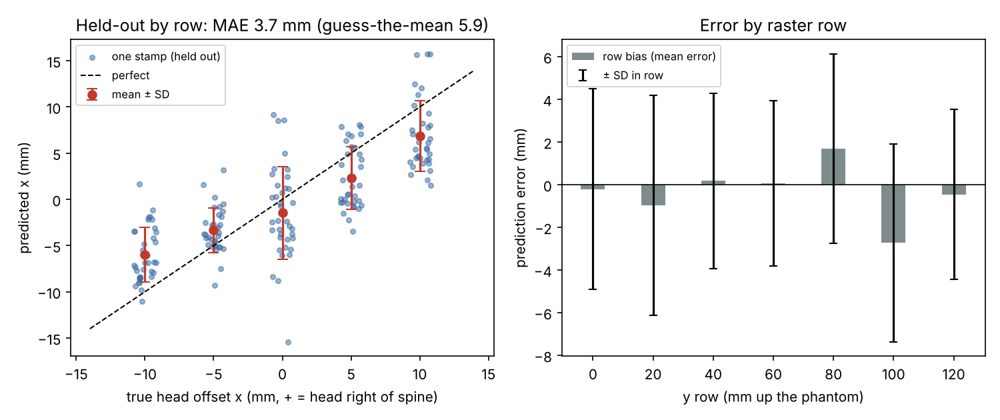
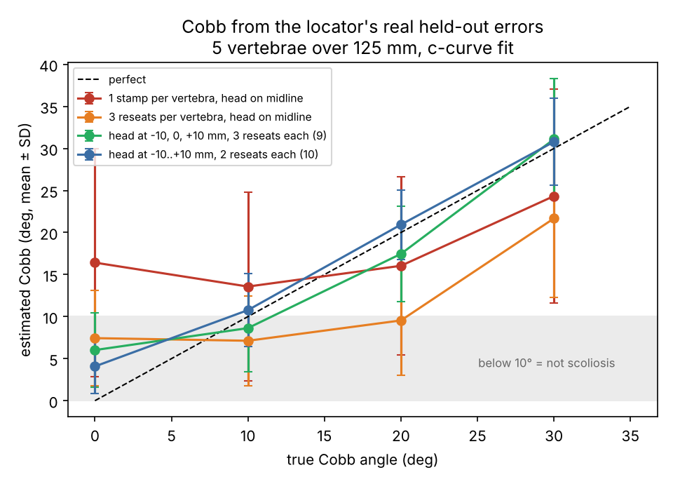

# Healthy-phantom stamps, 2026-11-22: locator and Cobb feasibility

> **Update 2026-11-24:** the severe-mold test (`analysis/severe_2026-11-23/README.md`) shows this
> healthy-trained locator mostly tracks where the head sits in the mold, not the spine. It read the
> 47° severe mold as 21°. The Cobb simulation below assumed errors carry over from healthy to scoliotic
> molds, so it is optimistic until the model is trained across molds. The process heights below come
> from bri's first estimate; the mold maps (`MOLDS` in `pc/piezo/locate.py`) supersede them.

Data: `pc/final_data` on bri's laptop (not in the repo). 177 vertebra stamps on the healthy phantom,
x = -10, -5, 0, +5, +10 mm (head right of spine) at y = 0, 20, ... 120 mm, 5 reseats each, depth
15 mm, plus 60 blanks (one before every block). One session. Head turned 90° clockwise (its up side
to the phantom's right): recorded dr -> dl, dl -> ul, ul -> ur, ur -> dr. The `.json` files say
`rotation_deg 0`; the turn is applied with `--turn cw90` instead of editing the data.

Reproduce: `cd pc && python locator.py train --data final_data --turn cw90 --bad-discs dl` then
`python cobb.py feasibility training/results/locator/predictions.csv`.

## What the data showed

- **The remap.** bri's two descriptions (up side to the right, and the four-way rename) agree with
  each other: both are a clockwise quarter turn. The data can't confirm it on its own, because the
  model learns each disc separately and scores the same either way. The remap matters when this
  model is used on data taken square, or when results are named by phantom side.
- **Recorded dl (GPIO33, phantom up-left after the turn) is intermittent.** Its noise in silence
  jumps between ~0.2 and ~15 counts from trial to trial, 12 % of its points are under 10 dB SNR, and
  in some trials it reads 0. Left out. The other three are healthy (median SNR 43-53 dB).
- **Blanks don't help the model.** Single blanks moved by 25-100 % between reseats, more than the
  vertebra effect, and subtracting the preceding blank made the locator worse (MAE 5.4 vs 3.9 mm).
  Each disc's share of the total cancels pressure/seating and works better.
- **The y effect in the raw features is drift.** Many features change steadily with y, but y rows
  were captured in order through the afternoon and the blanks drift the same way (e.g. up-right
  amplitude at 344 Hz falls 0.28 decades per hour in blanks and objects alike). y can't be learned
  from this batch.
- **The IMU x/y didn't work in this batch.** `imu_x_mm` is uncorrelated with the typed x (r = 0.03),
  is off by a median 53 mm (y: 87 mm), and imu_x and imu_y track each other (r = -0.91). The yaw is fine
  (SD 1.8°). The `imu_axes` were also left at `x,y` with the head turned. Use typed positions.

## Locator (spine left/right of the head)

Ridge regression on share log amplitude of 3 discs, 50-190 Hz (39 features). Held out one y row at
a time (7 folds, ridge strength picked inside each fold).

Ridge shrinks toward 0 (a true 10 mm read 6.5 mm), which would make a shifted spine look straighter.
The held-out predictions are put back on scale with a straight-line calibration (slope 0.63), stored
in the model. That makes each stamp noisier but unbiased, which is what the Cobb fit needs.

| | before calibration | calibrated (used) |
|---|---|---|
| mean abs error per stamp | 3.7 mm | 4.5 mm (guessing the mean: 5.9 mm) |
| mean by true x (-10, -5, 0, +5, +10) | -6.0, -2.9, -0.8, +0.7, +6.2 | -9.0, -4.8, -1.8, +4.2, +11.5 |
| side correct when 5-10 mm off | 88 % | 91 % |

Stamps with the spine right under the head are the noisiest (SD 8 mm at x = 0 vs 4-6 mm at ±5-10),
so stamps beside the spine carry more information than stamps on it. The 50-190 Hz band was picked
on this same data from four candidates, so expect slightly worse on new data. Up-down position
relative to a process isn't modelled (see above). The calibration line is fitted to the same
held-out predictions it is scored on.

## Cobb angle from a phantom with shifted (not rotated) vertebrae

bri's scoliotic phantoms have flat vertebrae that are only shifted sideways, so every stamp looks
like a healthy-phantom stamp at some offset, and these errors carry over directly. No tilt test needed.

**Phantom layout (bri, 2026-11-23).** 5 vertebrae. With the stamp y convention (mold bottom to
sensor bottom), each vertebra's spinous-process peak is at the centre of the 94 mm sensor when y is
about 0, 30, 60, 85 and 125 mm (the peak is 45-50 mm above the sensor's bottom edge). `locator.py`
labels every stamp with its nearest vertebra (`level`) and how far that process is above the sensor
centre (`dy_mm`). On 11-22 the rows y = 0 and 60 were centred on a process, 80 and 120 were 5 mm off,
and 20, 40, 100 were 10-15 mm off.

- **Side-to-side is most accurate when a process is centred:** 3.5 mm mean error at dy = 0, vs
  4.1-5.2 mm at 5-15 mm off. So stamp each vertebra centred.
- **Up-down position can't be learned from this batch.** Predicting dy did worse than guessing
  (9.1 vs 6.7 mm). With only 7 rows taken in order through the afternoon, drift swamps it. To learn
  it, stamp y in random order, including spots between vertebrae.

`cobb.py feasibility` bends the 5 vertebrae into a known Cobb angle (single C-curve over 125 mm). At
each vertebra the head is stamped centred on it in y, at fixed spots from the straight midline
(where the vertebra would be if centred). Each stamp gets a real held-out error at the nearest trained
offset, drawn from the 11-22 rows centred within 5 mm of a process (y = 0, 60, 80, 120), with whole
rows drawn together so row-level drift is kept. Estimated Cobb, mean ± SD of 1000 simulated scans,
and how often a scan reads ≥ 10°:

| stamps per vertebra | 0° | 10° | 20° | 30° |
|---|---|---|---|---|
| 1, head on midline | 16.4 ± 13.6 (60 %) | 13.6 ± 11.3 | 16.0 ± 10.6 | 24.3 ± 12.7 |
| 3 reseats, head on midline | 7.4 ± 5.7 (27 %) | 7.1 ± 5.3 | 9.5 ± 6.5 | 21.7 ± 9.4 |
| head at -10, 0, +10 mm, 3 reseats (9) | 6.0 ± 4.4 (19 %) | 8.6 ± 5.2 | 17.5 ± 5.6 | 31.1 ± 7.2 |
| **head at -10, -5, 0, +5, +10 mm, 2 reseats (10)** | **4.1 ± 3.2 (5 %)** | **10.8 ± 4.4** | **20.9 ± 4.1 (100 %)** | **30.8 ± 5.2** |
| same 5 spots, 5 reseats (25, like 11-22) | 3.1 ± 2.4 (0 %) | 11.1 ± 3.2 | 21.1 ± 2.9 | 31.0 ± 4.4 |

Only four real rows feed the error pool, so treat these spreads as a little optimistic. The healthy
phantom itself, from the 11-22 stamps placed at its 5 vertebrae, reads 7.9° (quadratic fit 9.8°).
Level 4 (y = 85) only has stamps from y = 80 and reads -4.8 mm, which drives most of that.

- Stamping only on the midline doesn't work: x = 0 is the model's noisiest offset.
- **Recommended: at each of the 5 vertebrae (y = 0, 30, 60, 85, 125), stamp the head at -10, -5, 0,
  +5, +10 mm from the midline, 2 reseats each.** That's 50 stamps per phantom. A healthy spine reads
  4 ± 3° and a 20° curve reads 21 ± 4°, so healthy vs 20°+ separates cleanly. 10° curves are
  borderline (about half read ≥ 10°).
- Keep each vertebra's shift within about ±10 mm of the head spots (the trained range). Above ~30°,
  move the spots along with the spine and type the head's real x.
- The angle measured is the angle of the line through the shifted vertebrae. On a patient, rotated
  vertebrae would make the surface line read lower than the X-ray Cobb; this phantom can't show that.

## Do you need to stamp scoliotic phantoms?

**Not to train.** The locator learns the head-to-spine offset, and the healthy phantom with the head
moved left/right gives exactly those offsets. **To validate, one scan** of a scoliotic phantom with a
designed Cobb angle (about 20-30°), stamped as recommended above (50 stamps), gives one real Cobb
reading to compare with the design. A second pass on another day gives repeatability. No blanks are
needed for the model (one every 30-45 min is enough to watch disc health).

## Next for better accuracy (healthy phantom)

- Fix recorded dl (GPIO33) so all four discs count.
- Randomise the order of x and y (this batch ran row by row, so y is confounded with time).
- A second session on another day, so the CV can hold out a whole session.
- Fix the IMU position (or use a printed grid), so a raster doesn't need typed positions.
- More head spots help more than more reseats at one spot; more rows (vertebrae) help the Cobb fit most.
